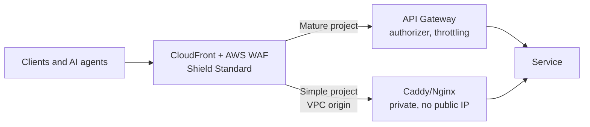

> Series "Golden pipeline" - Each POC represents my vision of a modern enterprise platform, exploring a different platform engineering decision: what to standardise, what to automate, what to delegate to managed services, and where teams should retain control.

# API Gateway vs Caddy/Nginx: Security and Reliability in the Age of AI

**Question:** what gives more security and reliability at the application's entry point: a managed service (AWS API Gateway) or a self-managed proxy (Caddy, Nginx, Traefik)?

**Scope:** the perimeter only, the point where the application meets the internet. Caddy/Nginx inside the infrastructure (between services, inside a cluster) are out of scope.

**Status:** reference architecture with examples. The Terraform passes `terraform validate` and `tflint` but has not been deployed. The Caddyfile and policies have not been run; the commands to check them are below.

Article on Medium: *link*

---

## Why this matters now

With the arrival of AI, security requirements have grown many times over. Finding vulnerabilities and writing exploits used to take weeks; now it takes hours. Applications written in previous years without AI are being actively broken with the help of AI, and many of them need architectural re-engineering. Using non-certified components at the system's entry point is a risk that must be accepted consciously.

## Where the threats come from

| Source | Example | Mitigation |
|---|---|---|
| Misconfiguration | Route without authorization, CloudFront bypass | Policy as code in the pipeline, one front door |
| Vulnerabilities in code and dependencies | Legacy code found by an attacker's AI scanner | Scanning and AI review of your own code |
| Unpatched edge | IngressNightmare in ingress-nginx (CVE-2025-1974, CVSS 9.8) | Managed service or automated patching |
| Stolen keys | Long-lived keys in CI | OIDC, short-lived roles |
| Automated attacks | Bots, credential stuffing, L7 DDoS | AWS WAF, Shield, throttling |
| AI agents with privileges | Prompt injection into an admin agent | Read-only agent, code decides |

## Process approach: who performs the ITIL practices

| ITIL practice | API Gateway (managed) | Caddy / Nginx / Traefik (self-managed) |
|---|---|---|
| Vulnerability and patch management | AWS | Your team |
| Availability and capacity management | AWS, 99.95% SLA | Full responsibility of your team: high availability, autoscaling, monitoring, patching |
| Change management and audit | Terraform + auditing with CloudTrail | Git + your own audit trail |
| Incident management | AWS Support + your alerts | Only your on-call |
| Supplier management | SOC 2, ISO 27001, PCI DSS reports in AWS Artifact | No independent certification; you collect the evidence yourself |

**Conclusion:** a managed service takes most operational processes off your hands and provides ready-made evidence for the auditor. A self-managed proxy moves them to your team.

## Selection criterion

Caddy/Nginx are acceptable **only if all conditions are met**:

- [ ] the service has no regulatory requirements (PCI DSS, SOC 2, ISO 27001);
- [ ] the service does not process payment or personal data;
- [ ] it is a prototype, an internal tool or a project with a small audience;
- [ ] a few hours of downtime are not critical for the business;
- [ ] a specific person is responsible for updating Caddy/Nginx.

If even one condition is not met, use API Gateway. The choice is made **per project, not per environment**: dev, stage and prod use the same entry point.

### API Gateway: HTTP API or REST API

| | HTTP API | REST API |
|---|---|---|
| Price (first tier, us-east-1) | $1.00 per million requests | $3.50 per million requests |
| JWT authorizer | Built in | Cognito or Lambda authorizer |
| AWS WAF attached directly | No: put it behind CloudFront + WAF | Yes |
| Usage plans, API keys | No | Yes |
| Canary releases | No | Yes |
| Response caching | No | Yes |

Stages in API Gateway are environments, not API versions. Versions are expressed by path (`/v1`, `/v2`) or by separate APIs, and environments are best kept in separate AWS accounts.

## Architecture



The front door is the same in both options. Caddy/Nginx replace only the API management layer, not DDoS protection and not the WAF.

## Entry point security

| Control | How |
|---|---|
| One front door | CloudFront + AWS WAF in front of all services; Shield Standard is on by default |
| No CloudFront bypass | AWS recommendations: **VPC origins** for ALB/NLB/EC2 (no public address), **Origin Access Control** for S3 and Lambda URLs; for everything else, a secret header from CloudFront verified at the origin (WAF) plus the managed prefix list `com.amazonaws.global.cloudfront.origin-facing` in the security group |
| Authorization on every route | JWT, Cognito or IAM; exceptions are explicit (health check) |
| Backend overload protection | Throttling. It does not protect against DDoS: that is the job of Shield and WAF |
| Changes | Only through Git and a pipeline, no manual edits in the console |
| CI access | OIDC, no long-lived keys |
| Audit | CloudTrail: who changed what. Access logs: who requested what |

**Deliberately out of scope** (production work, not omissions): WAF rule tuning and false-positive handling, bot management, mTLS to the backend, multi-region, rotation of the secret header.

## Cost

Cost = AWS bill + engineering time + cost of risk. Prices are estimates (us-east-1), excluding CloudFront and data transfer, which are the same in both options.

| Requests per month | HTTP API | REST API | Caddy/Nginx (2× t4g.small + NLB) |
|---|---|---|---|
| 10 M | ~$10 | ~$35 | ~$45 |
| 100 M | ~$100 | ~$350 | ~$45 |
| 1 B | ~$930 | ~$3,000 | ~$100–200 |

- **Simple project:** CloudFront flat-rate pricing plans (including a free one) already include WAF and DDoS protection.
- **Self-managed is cheaper** only at hundreds of millions of requests per month, and only if engineering time is not counted: one engineer-day per month costs more than HTTP API at that volume.
- **Cost control:** Infracost in pull requests and AWS Budgets in the account.

## Reliability

| | API Gateway | Caddy/Nginx |
|---|---|---|
| Availability | AWS SLA 99.95% | Your design: at least 2 instances across AZs, health checks |
| Typical failure | Regional 10,000 RPS quota exhausted, bad configuration change | Config error, CVE in the image, lack of capacity at peak |
| Limits | ~30 s timeout, 10 MB payload | Only your own |

## How AI helps with defense

The rule: **AI explains, deterministic code decides.**

```text
PR → fmt/validate/tflint → plan → conftest (policy) → AI review → approve → apply
                                     │                    │
                              blocks the merge    explains the diff, no rights
```

- **AI review of changes:** reads the Terraform plan and the policy results and writes a PR comment, for example "the POST /orders route is left without authorization". It has no merge rights and no cloud access.
- **AI log analysis:** anomalies in WAF and access logs, draft WAF rules. A human applies them through a PR.
- **AI against your own code:** finding vulnerabilities in legacy code before attackers do.
- **Security of the agent:** read-only, no secrets.

## Examples

| File | What it shows | Verification |
|---|---|---|
| [`examples/terraform/main.tf`](examples/terraform/main.tf) | HTTP API: JWT authorizer, throttling, JSON access logs | `terraform validate` and `tflint` pass; not deployed |
| [`examples/caddy/Caddyfile`](examples/caddy/Caddyfile) | Caddy: security headers, `forward_auth`, 90/10 canary, health checks, JSON logs | Not run |
| [`examples/policy/edge.rego`](examples/policy/edge.rego) | Conftest: route without authorizer, stage without throttling | Not run |

### Verify

```bash
# Caddyfile (from this folder)
caddy validate --config examples/caddy/Caddyfile --adapter caddyfile

# Terraform and policies against a real plan
cd examples/terraform
terraform init -backend=false && terraform validate && tflint
terraform plan -out plan.out && terraform show -json plan.out > plan.json
conftest test plan.json -p ../policy
```

### Deploy and destroy

```bash
cd examples/terraform
terraform apply -var oidc_issuer=... -var oidc_audience=... -var backend_url=https://...
terraform destroy
```

The example creates only an API Gateway and a log group. With no traffic it costs almost nothing.

## Trade-offs and next steps

- **Default:** CloudFront + AWS WAF + API Gateway, the same in every environment.
- **Exception:** Caddy/Nginx behind the same front door, for simple projects that meet the criterion above.
- **Never:** different entry points in dev and prod, or a public proxy without CloudFront and WAF.

---

If any of the ideas or terms here are unclear, feel free to reach out to me on LinkedIn: https://www.linkedin.com/in/alexander-ilves-2009/
